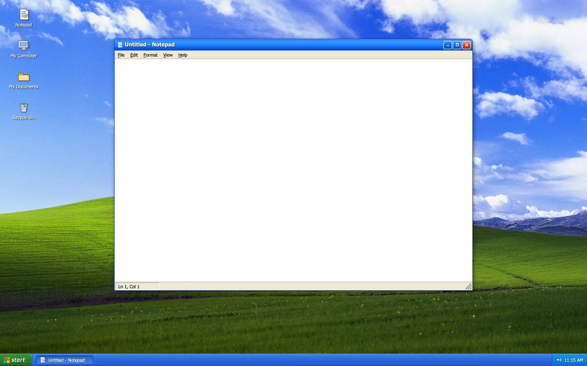

<div align="center">

# Windows XP Notepad

A nostalgic, pixel-inspired recreation of Windows XP Notepad — desktop, taskbar, Start menu, dialogs and all — built with Next.js and [ui-sdk](https://ui-sdk.dev).

[](https://nextjs.org)
[](https://react.dev)
[](https://ui-sdk.dev)
[](#testing)



</div>

## Features

**The desktop**
- Bliss wallpaper (served through `next/image`), desktop icons, and the XP Luna window chrome.
- Draggable, resizable, minimizable and maximizable Notepad window with a taskbar button.
- Two-column Start menu with Log Off / Turn Off Computer footer buttons.
- Taskbar with a live clock, tray and Start button.

**The editor**
- Real text editing with caret tracking (`Ln x, Col y`), word wrap and a toggleable status bar.
- Undo/redo history, Cut / Copy / Paste / Delete, Select All.
- Find, Find Next, Replace, Replace All — with **Match case** and **Direction: Up / Down**.
- Go To line, and Time/Date insertion (F5).
- Open and Save/Save As through the File System Access API, with input/download fallbacks.
- A print layout with a real header and footer.

**Dialogs**
- Font (family, style, size, sample, Apply).
- Page Setup (paper, orientation, margins, header/footer).
- Find, Replace, Go To, About, and an unsaved-changes alert.

**Accessibility and agents**
- Every menu item and control has an explicit accessible name; mnemonics are visual only.
- Full keyboard access: menu accelerators plus the classic shortcuts.
- The editor is agent-ready via `window.notepadAgent`, with confirmation for destructive actions.

## Tech stack

| | |
| --- | --- |
| Framework | [Next.js 16.4](https://nextjs.org) (App Router, Turbopack, Cache Components) |
| UI | [React 19.3](https://react.dev) + [ui-sdk](https://ui-sdk.dev) (`@ui-sdk/react`) |
| Styling | Tailwind CSS v4 plus hand-written XP CSS in `app/notepad/notepad.css` |
| Testing | Vitest + Testing Library + jsdom |
| Language | TypeScript |

ui-sdk provides the menubar and menus, textarea, dialogs, buttons, inputs, selects, checkboxes, radios and the agent bridge. The Windows XP look is layered on top with custom CSS.

## Getting started

Requires **Node.js 20.9 or newer** and npm.

```bash
npm install
npm run dev
```

Open [http://localhost:3000](http://localhost:3000).

### Scripts

| Command | What it does |
| --- | --- |
| `npm run dev` | Turbopack dev server at `http://localhost:3000` |
| `npm run build` | Production build (also validates Cache Components) |
| `npm start` | Serve the production build |
| `npm run lint` | ESLint |
| `npm test` | Run the Vitest suite once |
| `npm run test:watch` | Run tests in watch mode |
| `npx next typegen && npx tsc --noEmit` | Typecheck |

## Project structure

```text
app/
  page.tsx              Renders <Notepad />
  layout.tsx            Root layout and metadata
  globals.css           Tailwind import and ui-sdk layer order
  notepad/
    notepad.tsx         Window shell, state, commands, shortcuts, printing
    menus.tsx           Menu bar and Start menu
    dialogs.tsx         Font, Find, Replace, Go To, Page Setup, About, unsaved alert
    notepad.css         All Windows XP styling: chrome, taskbar, dialogs, print, mobile
    icons.tsx           Inline SVG icons
    types.ts            Shared types, font lists, defaults
    file-system.ts      File System Access API helpers
    agent.ts            ui-sdk agent bridge exposed as window.notepadAgent
    notepad.test.tsx    Editor and dialog tests
public/
  img-wallpaper.jpeg    Desktop wallpaper
docs/
  preview.png           Screenshot used in this README
```

## Keyboard shortcuts

| Shortcut | Action |
| --- | --- |
| `Ctrl+N` / `Ctrl+O` / `Ctrl+S` | New / Open / Save |
| `Ctrl+P` | Print |
| `Ctrl+Z` / `Ctrl+Y` | Undo / Redo |
| `Ctrl+X` / `Ctrl+C` / `Ctrl+V` | Cut / Copy / Paste |
| `Ctrl+A` | Select All |
| `Ctrl+F` / `F3` | Find / Find Next |
| `Ctrl+H` | Replace |
| `Ctrl+G` | Go To |
| `F5` | Insert time and date |
| `Alt` + underlined letter | Open a menu |

## Page Setup codes

Header and footer fields support the classic Notepad tokens:

| Code | Prints |
| --- | --- |
| `&f` | File name |
| `&d` | Current date |
| `&t` | Current time |
| `&p` | Page number |
| `&l` / `&c` / `&r` | Align left / center / right |

The default footer is `Page &p`.

## Agent integration

The app registers its controls with the ui-sdk agent runtime. In the browser console you can try:

```js
window.notepadAgent
```

The bridge exposes the page as a structured, accessible surface so an agent can read and act on it. Closing the window with unsaved text asks for confirmation before discarding work.

## Testing

```bash
npm test        # 7 tests: agent control, word wrap, status bar, unsaved prompt,
                # font apply/cancel, Find Up + Match case, guarded exit
npm run lint
npx next typegen && npx tsc --noEmit
npm run build
```

## Deploying

The page is a static shell, so it deploys anywhere that runs Next.js. On [Vercel](https://vercel.com/new), import the repository and deploy — no extra configuration needed. For a self-hosted setup:

```bash
npm run build
npm start
```

## Notes and credits

- This is a fan-made tribute. Windows XP, Notepad and the Bliss wallpaper are trademarks and copyrights of Microsoft; this project is not affiliated with or endorsed by Microsoft.
- The wallpaper in `public/img-wallpaper.jpeg` is included for the demo. Replace it with your own image of the same name if you plan to redistribute the project.
- Built with [ui-sdk](https://ui-sdk.dev) for the interface primitives and agent tooling.
